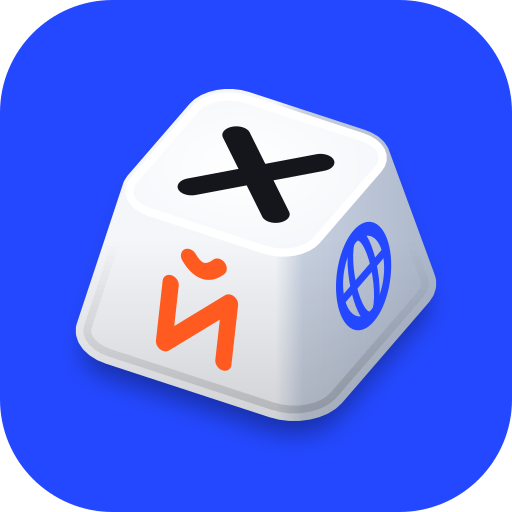

# JustType

A macOS menu-bar app that fixes text typed in the wrong keyboard layout,
for Bulgarian (BDS) and English. Type `icyf` with the US layout active and
it becomes `също`.

Instead of a dictionary lookup, JustType runs a tiny character-level GRU
on every keystroke. That lets it handle short words, unknown words and
mixed text, and it often catches the mistake before you finish the word.

## How it compares

Live run on the same 60 typing episodes, keys sent as real keyboard events:

|          | missed wrong-layout words | broke correct words | episodes exactly right |
|----------|--------------------------:|--------------------:|-----------------------:|
| JustType | 5.3%                      | 3.8 per 1k          | 90%                    |
| Rekey    | 18.1%                     | 1.3 per 1k          | 75%                    |

Its weak spot is English slang and tech terms inside Bulgarian text, which
it sometimes "fixes" when it shouldn't.

## Install

Requires macOS 13+ and Xcode command-line tools.

```sh
cd live
./install.sh     # builds, signs locally, installs to /Applications, starts at login
./uninstall.sh   # removes everything, including the signing identity
```

macOS will ask for Accessibility access; that's the only permission it needs.
Use the menu to pause it or to ignore the frontmost app.

> **Experimental.** It installs a keyboard event tap. The Mac it was developed
> on restarted twice during testing; the cause wasn't pinned down. Use at your
> own risk.

## Repo layout

- `live/` – the Swift app (`swift build`), model weights in `live/Resources/`
- `bench/` – Python training and offline benchmark (dict baselines vs the model)
- `results/` – benchmark output

To retrain, put the Leipzig, OpenSubtitles and Tatoeba corpora under
`data/raw/` (see `bench/data.py`), then `bench/model.py` trains,
`bench/run.py` benchmarks and `bench/export.py` writes the weights for the app.

## License

[MIT](LICENSE)
